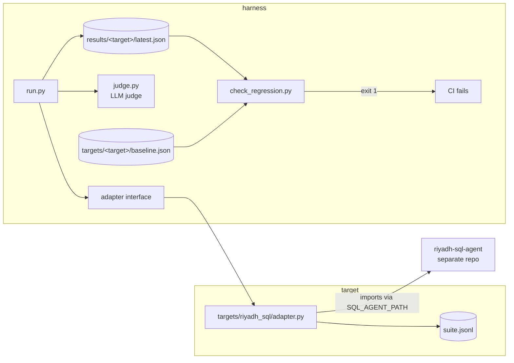

# agent-eval-harness

A standalone test harness for LLM agents. It runs an agent against a test suite,
grades it two ways — a deterministic check and an LLM judge — records accuracy,
judge pass rate, latency, tokens and cost, and **fails the build when the
results regress against a committed baseline**. On every pull request, GitHub
Actions runs it for each registered agent and writes the results table to the
job summary.

The judge is itself measured: its verdicts are compared against human labels and
the agreement rate and Cohen's kappa are published in the repo
(`targets/<agent>/judge_validation.md`).

The first agent wired up is [riyadh-sql-agent](https://github.com/moehersi/riyadh-sql-agent),
a LangGraph text-to-SQL agent over a Riyadh food-delivery SQLite database.

## Why not just run the agent's own eval?

The agent's own eval set was saturated: `gemini-flash-lite` scored 20/20, so it
could not detect a regression — a 20/20 score tells you nothing until it breaks,
and by then you have no idea which direction things were moving. The harness
exists to fix three specific things:

1. **A suite with headroom.** 49 cases including multi-table joins, `HAVING`,
   window functions, date filters on TEXT dates, colloquial Arabic, and cases the
   agent is supposed to *refuse*.
2. **Grading the answer, not just the rows.** Matching result rows cannot catch
   an agent that returns the right rows and then describes them wrongly, invents a
   figure, or answers an Arabic question in English. That needs a judge.
3. **A tripwire.** Metrics in a README rot. A committed baseline plus a non-zero
   exit code does not.

## Architecture



| file | job |
|---|---|
| `harness/adapter.py` | The one interface, plus the suite/target loaders. No base class, no registry. |
| `harness/run.py` | Runs a suite, grades it both ways, writes `results/<target>/latest.json`. Holds the price table. |
| `harness/judge.py` | The judge prompt and verdict parsing. Nothing else in the repo contains a grading prompt. |
| `harness/llm.py` | The judge's own LLM client, the retry policy and the rate-limit throttle. |
| `harness/check_regression.py` | Compares the run to the baseline, prints a markdown diff, exits non-zero on a regression. |
| `harness/validate_judge.py` | Exports cases for human labelling, then computes agreement and Cohen's kappa. |
| `targets/<name>/` | One agent: `adapter.py`, `suite.jsonl`, `baseline.json`, and (optionally) `labels.csv` + `judge_validation.md`. |

Deliberately absent: a plugin system, a config file format, a class hierarchy, a
dashboard. A target is a folder; `--target <folder name>` is the whole registry.

## The adapter interface

An agent joins the harness by implementing one function, and optionally three more:

```python
def run(case: dict) -> dict:
    """-> {answer, raw, latency_s, tokens_in, tokens_out}

    answer     the natural-language answer; this is what the judge grades
    raw        whatever the agent returned, for debugging and for score()
    latency_s  wall-clock seconds for the agent call
    tokens_in/out  0 if the backend reports no usage
    """

def score(case: dict, output: dict) -> bool:   # optional: the deterministic check
def gold(case: dict):                          # optional: ground truth to show the judge
def code_hash() -> str:                        # optional: busts the output cache when the agent changes
```

## How to add a second agent

Say you have an invoice extractor that returns structured JSON. Three files, no
harness changes:

```
targets/invoice_extractor/
    adapter.py
    suite.jsonl
    baseline.json      # written for you by --update-baseline
```

`suite.jsonl`, one case per line. `id`, `question` and `kind` are all the harness
reads; everything else is yours:

```json
{"id": "inv01", "kind": "query", "lang": "en", "question": "<the invoice text>", "gold_total": 1250.00}
```

`adapter.py`:

```python
import time
from my_extractor import extract          # your agent, however you import it

def run(case):
    t0 = time.perf_counter()
    result = extract(case["question"])    # {"total": 1250.0, "summary": "..."}
    return {
        "answer": result["summary"],
        "raw": result,
        "latency_s": time.perf_counter() - t0,
        "tokens_in": result.get("tokens_in", 0),
        "tokens_out": result.get("tokens_out", 0),
    }

def score(case, output):
    return output["raw"]["total"] == case["gold_total"]

def gold(case):
    return {"total": case["gold_total"]}
```

Then:

```bash
python harness/run.py --target invoice_extractor
python harness/check_regression.py --target invoice_extractor --update-baseline   # accept run 1
git add targets/invoice_extractor && git commit -m "Add the invoice extractor target"
```

CI picks it up with no edit to the workflow — it loops over every folder in
`targets/` that contains a `suite.jsonl`. Only the extra `actions/checkout` step
for the agent's own repo has to be added.

## Running it

```bash
python -m venv .venv && .venv\Scripts\activate     # Windows
pip install -r requirements.txt
copy .env.example .env                              # then paste your free Gemini key

# the agent under test needs its database built once
set SQL_AGENT_PATH=..\riyadh-sql-agent
python ..\riyadh-sql-agent\load_db.py

python harness/run.py --target riyadh_sql           # writes results/riyadh_sql/latest.json
python harness/check_regression.py --target riyadh_sql
pytest -q
```

Useful flags: `--limit N` runs the first N cases only (smoke tests), `--no-cache`
ignores cached agent outputs.

## The suite

`targets/riyadh_sql/suite.jsonl`, 49 cases:

| | count |
|---|---|
| carried over from the agent's own `questions.json` | 20 |
| new, harder cases | 25 |
| cases the agent must refuse | 4 |
| Arabic (5 of them colloquial/ambiguous) | 9 |

Tags across the suite: `join`/`join3` 12, `rank` 10, `date` 9, `having` 7,
`window` 5, `subquery` 2, `ambiguous` 5, `decline` 4.

Every gold SQL was run against `riyadh.db` and kept only if it returned
non-empty, tie-free results. Four drafts failed that check and were rewritten:
two returned nothing (every district has exactly 60 customers; no customer has 4
orders) and two were decided by a tie (five of six categories share a
highest-value order; two customers in Al Malaz are tied on spend). `pytest`
re-runs every gold query, so if the data shifts under the suite the tests say so.

## Grading

**Deterministic score.** For a query case, the agent's rows are matched against
the gold SQL's rows using `eval.correct` imported from the agent's own repo —
the same lenient matcher the agent is already judged by, so the two numbers mean
the same thing. For a decline case, the score passes only if the answer is the
agent's exact refusal string: an answer that talks its way around a missing
column is a fail, however fluent.

**LLM judge** (`harness/judge.py`, temperature 0, JSON verdict). Three criteria,
all of which must hold:

1. **correct facts** — the claim matches the gold result
2. **no invented numbers** — every number and name appears in the gold result or the question
3. **same language** — an Arabic question gets an Arabic answer

An unparseable judge reply counts as FAIL, never as a silent pass. The judge
prompt is separate from every agent prompt and the two never see each other.

## Regression check

`check_regression.py` exits non-zero when any of these holds:

| gate | threshold |
|---|---|
| deterministic accuracy dropped | > 5 percentage points |
| judge pass rate dropped | > 5 percentage points |
| p95 latency rose | > 30% |
| a case that passed in the baseline now fails | any single case |

The per-case gate is the one that catches a swap: an agent that breaks two cases
and fixes two others leaves the headline numbers untouched. It is also the gate
that fails first in practice.

### Updating a baseline

A baseline is only ever updated on purpose:

```bash
python harness/run.py --target riyadh_sql                              # see the new numbers
python harness/check_regression.py --target riyadh_sql                 # read the diff table
python harness/check_regression.py --target riyadh_sql --update-baseline
git add targets/riyadh_sql/baseline.json && git commit
```

The baseline stores the metrics plus each case's pass/fail — a tripwire, not an
archive of answers. Reviewing the diff table before accepting it is the whole
point; `--update-baseline` on a red run is how a regression gets laundered into
the baseline.

## Staying inside the free tier

The Gemini free tier is a real constraint, and three things keep the harness
inside it:

- **Throttle.** Requests are spaced to `LLM_RPM` (default 15/min). Without it the
  free tier returns 429s and the retry backoff sleeps *inside* the measured call —
  an early run recorded 53.8s for a question that actually takes 1.4s, which would
  have made the p95 latency gate a reading of Google's rate limiter. The throttle's
  own waiting is subtracted from the reported latency.
- **Retry.** `with_retry` (exponential backoff with jitter) absorbs the 429s that
  still get through.
- **Cache.** Agent outputs are cached under `.cache/<target>/<agent code hash>/`,
  keyed by target, case and a hash of the agent's source. Re-running after a
  harness-only change costs judge calls only. Each case runs once per CI run.

## Responsible use of the agent under test

The harness only ever calls the agent's public entry point. It does not touch the
agent's read-only SQL guard, and `use_lessons=False` means no `lessons.json` is
written: a measurement that depends on every run before it is not a measurement.

## Stack

Python, LangGraph, LangChain (Gemini free tier, or local Ollama), SQLite, pytest,
GitHub Actions. No dependency the agent under test did not already have.
