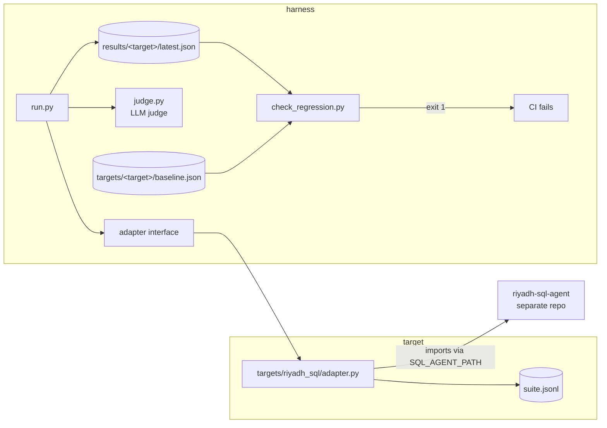

# agent-eval-harness

A standalone test harness for LLM agents. It runs an agent against a test suite,
grades it two ways — a deterministic check and an LLM judge — records accuracy,
judge pass rate, latency, tokens and cost, and **fails the build when the
results regress against a committed baseline**. On every pull request, GitHub
Actions runs it for each registered agent and writes the results table to the
job summary.

The judge is itself measured: its verdicts are compared against human labels and
the agreement rate and Cohen's kappa are published in the repo
(`targets/<agent>/judge_validation.md`).

The first agent wired up is [riyadh-sql-agent](https://github.com/moehersi/riyadh-sql-agent),
a LangGraph text-to-SQL agent over a Riyadh food-delivery SQLite database.

New to any of this? [`WALKTHROUGH.md`](WALKTHROUGH.md) explains every idea in the
harness in plain language, including the five bugs found while building it.
[`NEXT.md`](NEXT.md) records exactly where the work stands and what is left.

## Why not just run the agent's own eval?

The agent's own eval set was saturated: `gemini-flash-lite` scored 20/20, so it
could not detect a regression — a 20/20 score tells you nothing until it breaks,
and by then you have no idea which direction things were moving. The harness
exists to fix three specific things:

1. **A suite with headroom.** 49 cases including multi-table joins, `HAVING`,
   window functions, date filters on TEXT dates, colloquial Arabic, and cases the
   agent is supposed to *refuse*.
2. **Grading the answer, not just the rows.** Matching result rows cannot catch
   an agent that returns the right rows and then describes them wrongly, invents a
   figure, or answers an Arabic question in English. That needs a judge.
3. **A tripwire.** Metrics in a README rot. A committed baseline plus a non-zero
   exit code does not.

## Architecture



| file | job |
|---|---|
| `harness/adapter.py` | The one interface, plus the suite/target loaders. No base class, no registry. |
| `harness/run.py` | Runs a suite, grades it both ways, writes `results/<target>/latest.json`. Holds the price table. |
| `harness/judge.py` | The judge prompt and verdict parsing. Nothing else in the repo contains a grading prompt. |
| `harness/llm.py` | The judge's own LLM client, the retry policy and the rate-limit throttle. |
| `harness/check_regression.py` | Compares the run to the baseline, prints a markdown diff, exits non-zero on a regression. |
| `harness/validate_judge.py` | Exports cases for blind human labelling, then computes agreement and Cohen's kappa. |
| `targets/<name>/` | One agent: `adapter.py`, `suite.jsonl`, `baseline.json`, and (optionally) `labels.csv` + `judge_validation.md`. |

Deliberately absent: a plugin system, a config file format, a class hierarchy, a
dashboard. A target is a folder; `--target <folder name>` is the whole registry.

## The adapter interface

An agent joins the harness by implementing one function, and optionally three more:

```python
def run(case: dict) -> dict:
    """-> {answer, raw, latency_s, tokens_in, tokens_out}

    answer     the natural-language answer; this is what the judge grades
    raw        whatever the agent returned, for debugging and for score()
    latency_s  wall-clock seconds for the agent call
    tokens_in/out  0 if the backend reports no usage
    """

def score(case: dict, output: dict) -> bool:   # optional: the deterministic check
def gold(case: dict):                          # optional: ground truth to show the judge
def code_hash() -> str:                        # optional: busts the output cache when the agent changes
```

## How to add a second agent

Say you have an invoice extractor that returns structured JSON. Three files, no
harness changes:

```
targets/invoice_extractor/
    adapter.py
    suite.jsonl
    baseline.json      # written for you by --update-baseline
```

`suite.jsonl`, one case per line. `id`, `question` and `kind` are all the harness
reads; everything else is yours:

```json
{"id": "inv01", "kind": "query", "lang": "en", "question": "<the invoice text>", "gold_total": 1250.00}
```

`adapter.py`:

```python
import time
from my_extractor import extract          # your agent, however you import it

def run(case):
    t0 = time.perf_counter()
    result = extract(case["question"])    # {"total": 1250.0, "summary": "..."}
    return {
        "answer": result["summary"],
        "raw": result,
        "latency_s": time.perf_counter() - t0,
        "tokens_in": result.get("tokens_in", 0),
        "tokens_out": result.get("tokens_out", 0),
    }

def score(case, output):
    return output["raw"]["total"] == case["gold_total"]

def gold(case):
    return {"total": case["gold_total"]}
```

Then:

```bash
python harness/run.py --target invoice_extractor
python harness/check_regression.py --target invoice_extractor --update-baseline   # accept run 1
git add targets/invoice_extractor && git commit -m "Add the invoice extractor target"
```

CI picks it up with no edit to the workflow — it loops over every folder in
`targets/` that contains a `suite.jsonl`. Only the extra `actions/checkout` step
for the agent's own repo has to be added.

## Running it

```bash
python -m venv .venv && .venv\Scripts\activate     # Windows
pip install -r requirements.txt
copy .env.example .env                              # then paste your free Gemini key

# the agent under test needs its database built once
set SQL_AGENT_PATH=..\riyadh-sql-agent
python ..\riyadh-sql-agent\load_db.py

python harness/run.py --target riyadh_sql           # writes results/riyadh_sql/latest.json
python harness/check_regression.py --target riyadh_sql
pytest -q
```

Useful flags: `--limit N` runs the first N cases only (smoke tests), `--no-cache`
ignores cached agent outputs.

## The suite

`targets/riyadh_sql/suite.jsonl`, 49 cases:

| | count |
|---|---|
| carried over from the agent's own `questions.json` | 20 |
| new, harder cases | 25 |
| cases the agent must refuse | 4 |
| Arabic (5 of them colloquial/ambiguous) | 9 |

Tags across the suite: `join`/`join3` 12, `rank` 10, `date` 9, `having` 7,
`window` 5, `subquery` 2, `ambiguous` 5, `decline` 4.

Every gold SQL was run against `riyadh.db` and kept only if it returned
non-empty, tie-free results. Four drafts failed that check and were rewritten:
two returned nothing (every district has exactly 60 customers; no customer has 4
orders) and two were decided by a tie (five of six categories share a
highest-value order; two customers in Al Malaz are tied on spend). `pytest`
re-runs every gold query, so if the data shifts under the suite the tests say so.

## Results

Every number below comes from a real run on this machine, written by
`harness/run.py`. The committed baseline is `targets/riyadh_sql/baseline.json`.

Agent `gemini-flash-lite-latest`, judge `gemini-flash-lite-latest`, 49 cases,
run of 2026-10-19:

| metric | value |
|---|---|
| deterministic accuracy | 89.8% (44/49) |
| judge pass rate | 87.8% (43/49) |
| p50 latency | 2.07s |
| p95 latency | 4.16s |
| agent tokens in/out | 20,903 / 4,085 |
| judge tokens in/out | 17,508 / 1,977 |
| estimated cost per question | $0.00 (free tier; tokens are the figure that matters) |
| LLM calls retried for rate limits | 0 |

For comparison, the agent's own 20-question set scores **20/20** with the same
model. The point of the harness is the 49-case suite that does not.

### What the two gates each caught

Six cases failed. Three of them are the reason an LLM judge is in the harness at
all:

| case | what happened | deterministic | judge |
|---|---|---|---|
| `d04` | Asked in Arabic for a 5-star delivery rating, which is not in the database, the agent ran `SELECT avg(actual_delivery_min)` and answered "متوسط تقييم العملاء... هو 34.32" — reporting average delivery **minutes** as a star rating. | FAIL | FAIL |
| `a04` | Wrote `WHERE district = 'الملز'` instead of `'Al Malaz'`, got zero rows, and confidently answered "0 customers". The true answer is 30. | FAIL | FAIL |
| `h08` | Returned all 12 correct monthly rows, then summarised them as a range instead of answering per month. **Rows right, answer wrong.** | pass | FAIL |
| `h09` | Grouped by `month_name` instead of `YYYY-MM`, so the rows do not match the gold result. | FAIL | FAIL |
| `h10` | Computed Al Olaya at 8546.0 SAR against a gold 8691.0. | FAIL | FAIL |
| `d03` | Declined in prose ("the phone number... is not available") instead of the fixed refusal string. | FAIL | FAIL |

`h08` is the case that justifies the judge: the rows matched the gold SQL exactly,
so every row-matching eval in the world passes it, and the answer still does not
answer the question. `d04` is the case that justifies the "no invented numbers"
criterion — a confident number with a plausible unit attached.

## Grading

**Deterministic score.** For a query case, the agent's rows are matched against
the gold SQL's rows using `eval.correct` imported from the agent's own repo —
the same lenient matcher the agent is already judged by, so the two numbers mean
the same thing. For a decline case, the score passes only if the answer is the
agent's exact refusal string: an answer that talks its way around a missing
column is a fail, however fluent.

**LLM judge** (`harness/judge.py`, temperature 0, JSON verdict). Three criteria,
all of which must hold:

1. **correct facts** — the claim matches the gold result
2. **no invented numbers** — every number and name appears in the gold result or the question
3. **same language** — an Arabic question gets an Arabic answer

An unparseable judge reply counts as FAIL, never as a silent pass. The judge
prompt is separate from every agent prompt and the two never see each other.

### Is the judge any good?

A judge nobody checked is just a second opinion with extra steps, so this one is
measured against human labels and the result is committed to the repo:
`targets/riyadh_sql/judge_validation.md`.

Labelling is **blind**. `--export` writes two files:

| file | contents |
|---|---|
| `labels-blind.csv` | what the human labels: id, question, gold result, agent answer, empty `human_label`. No judge verdict, no judge reason, and the rows shuffled so the judge's failures are not grouped together. |
| `labels.csv` | the same cases in id order *with* the judge's verdict and reason, as the record. |

`--compute` joins the two by case id. A labeller who can see the judge's answer
is not an independent rater, and the agreement number would be measuring
anchoring instead of the judge. Re-exporting refuses to overwrite labels already
filled in unless you pass `--force`.

```bash
python harness/validate_judge.py --target riyadh_sql --export 30
# fill in human_label (PASS / FAIL) in targets/riyadh_sql/labels-blind.csv
python harness/validate_judge.py --target riyadh_sql --compute
```

The sample is stratified, not random: every case the judge failed is included,
plus PASS cases drawn with a fixed seed. A random 30 out of a suite the judge
passes 88% of would hold three or four failures, and the kappa would be noise.
That makes the published figure agreement *on this sample*, which over-weights
the hard cases on purpose — `judge_validation.md` says so next to the number.

**Measured on 30 blind human labels:**

| | value |
|---|---|
| raw agreement | 96.7% |
| Cohen's kappa | 0.889 |

| | human PASS | human FAIL |
|---|---|---|
| judge PASS | 24 | 0 |
| judge FAIL | 1 | 5 |

No false passes: the judge never waved through an answer the human failed. The
one disagreement is `d03`, where the judge is *stricter* than the human rubric —
the agent said "the phone number for customer CUST001 is not available", the
human counted that as a refusal, and the judge wanted a plain refusal with no
explanation. That is a rubric gap, not a judge error, and it is recorded in
`judge_validation.md` rather than smoothed away.

## Regression check

`check_regression.py` exits non-zero when any of these holds:

| gate | threshold |
|---|---|
| deterministic accuracy dropped | > 5 percentage points |
| judge pass rate dropped | > 5 percentage points |
| p95 latency rose | > 30% |
| a case that passed in the baseline now fails | twice in a row (see below) |

The per-case gate is the one that catches a swap: an agent that breaks two cases
and fixes two others leaves the headline numbers untouched. It is also the gate
that fails first in practice.

### Temperature 0 is not determinism

Two identical back-to-back runs of this agent, same code and same suite, **flipped
2 of 49 cases** (`h09` on the deterministic score, `h15` on the judge). So a
single new failure is not evidence of a regression.

A case that passed in the baseline and fails now therefore gets **exactly one
more go** before it counts, and only a case that fails twice fails the build. The
re-run is deliberately uncached - a cached re-run would replay the same answer and
prove nothing - and it is reported either way:

```
Passed on the re-run, so not counted as a regression: h09 (deterministic).
This agent flips a case or two between identical runs.
```

It fails closed: if the agent or judge cannot be reached, the re-run cannot clear
anything and the first failure stands, with the reason printed. `--no-rerun`
turns re-runs off for offline use. The rate gates are judged on the original run
only; the 5 pp thresholds already absorb this much noise.

### Proving the gate actually fires

A gate nobody watched fail is not known to work, so the agent's repo carries a
branch, `weak-prompt`, whose only change is a deliberately degraded prompt in
`generate`: the column names are dropped from the schema block (table names
only) and the "booleans are 0/1, dates are TEXT" hints are removed. It is the
realistic version of this regression — someone trimming a prompt to save tokens.

Run the harness against it with `SQL_AGENT_PATH` pointing at that branch, or in
CI with `workflow_dispatch` and `agent_ref: weak-prompt`.

**Measured on the full 49-case suite** (identical cases, identical judge,
identical harness, only the agent's source differs):

| metric | baseline | weakened prompt | change |
|---|---|---|---|
| deterministic accuracy | 89.8% | 18.4% | **-71.4 pp** |
| judge pass rate | 87.8% | 18.4% | **-69.4 pp** |
| p50 latency | 2.06s | 2.64s | +0.58s |
| p95 latency | 4.16s | 7.10s | **+71%** |

`check_regression.py --target riyadh_sql` exits **1** and fires every gate it
has:

- accuracy fell 71.4 pp (limit 5 pp)
- judge pass rate fell 69.4 pp (limit 5 pp)
- p95 latency rose 71% (limit 30%)
- 33 cases that passed in the baseline now fail twice (re-run did not clear
  them) — `a01 a02 a03 e02 e04 e05 e07 e08 e09 e10 e11 e12 e13 e14 e15 e16 e17
  e19 e20 h01 h02 h03 h05 h06 h07 h08 h11 h12 h13 h15 h16 h17 h20`

Two cases (`d03`, `d04`) newly pass — the weakened prompt happens to help the
refusal/rating cases, which is itself informative: a "drop the column names"
regression does not uniformly make every case worse, it is still caught
because the *aggregate* and the *per-case tripwire* both move. Four cases
(`a05`, `e18`, `h14`, `h18`) failed once and passed on the mandatory re-run —
the agent is non-deterministic at temperature 0, which is exactly why the gate
re-runs a suspect before counting it.

To reproduce:

```bash
cd ../riyadh-sql-agent && git checkout weak-prompt
cd ../agent-eval-harness
python harness/run.py --target riyadh_sql
python harness/check_regression.py --target riyadh_sql   # exits 1
cd ../riyadh-sql-agent && git checkout master            # never leave it weakened
```

### Updating a baseline

A baseline is only ever updated on purpose:

```bash
python harness/run.py --target riyadh_sql                              # see the new numbers
python harness/check_regression.py --target riyadh_sql                 # read the diff table
python harness/check_regression.py --target riyadh_sql --update-baseline
git add targets/riyadh_sql/baseline.json && git commit
```

The baseline stores the metrics plus each case's pass/fail — a tripwire, not an
archive of answers. Reviewing the diff table before accepting it is the whole
point; `--update-baseline` on a red run is how a regression gets laundered into
the baseline.

## Staying inside the free tier

The Gemini free tier has two limits, and the day limit is the one that bites:
**15 requests per minute and 500 per day** for `gemini-flash-lite-latest` (which
resolves to `gemini-3.5-flash-lite`). One full 49-case run costs **147 requests**
— 51 `generate` calls, 47 answer-node calls, 49 judge calls — so the free tier
allows about **three full runs a day**. Four things keep the harness inside it:

- **Throttle.** Requests are spaced to `LLM_RPM` (default 15/min). Without it the
  free tier returns 429s and the retry backoff sleeps *inside* the measured call —
  an early run recorded 53.8s for a question that actually takes 1.4s, which would
  have made the p95 latency gate a reading of Google's rate limiter. The throttle's
  own waiting is subtracted from the reported latency.
- **Retry, with a timeout.** Jittered exponential backoff absorbs the 429s that
  still get through. Every request also carries a 90s timeout
  (`LLM_TIMEOUT_S`): the client defaults to *no* timeout, and a single stalled
  request once hung a whole run — in CI that would hold a runner until its
  six-hour limit with nothing in the log.
- **Cache.** Agent outputs are cached under `.cache/<target>/<agent code hash>/`,
  keyed by target, case and a hash of the agent's source. Re-running after a
  harness-only change costs judge calls only. Each case runs once per CI run, plus
  at most one re-run per case that newly fails.

## Responsible use of the agent under test

The harness only ever calls the agent's public entry point. It does not touch the
agent's read-only SQL guard, and `use_lessons=False` means no `lessons.json` is
written: a measurement that depends on every run before it is not a measurement.

## Stack

Python, LangGraph, LangChain (Gemini free tier, or local Ollama), SQLite, pytest,
GitHub Actions. No dependency the agent under test did not already have.
